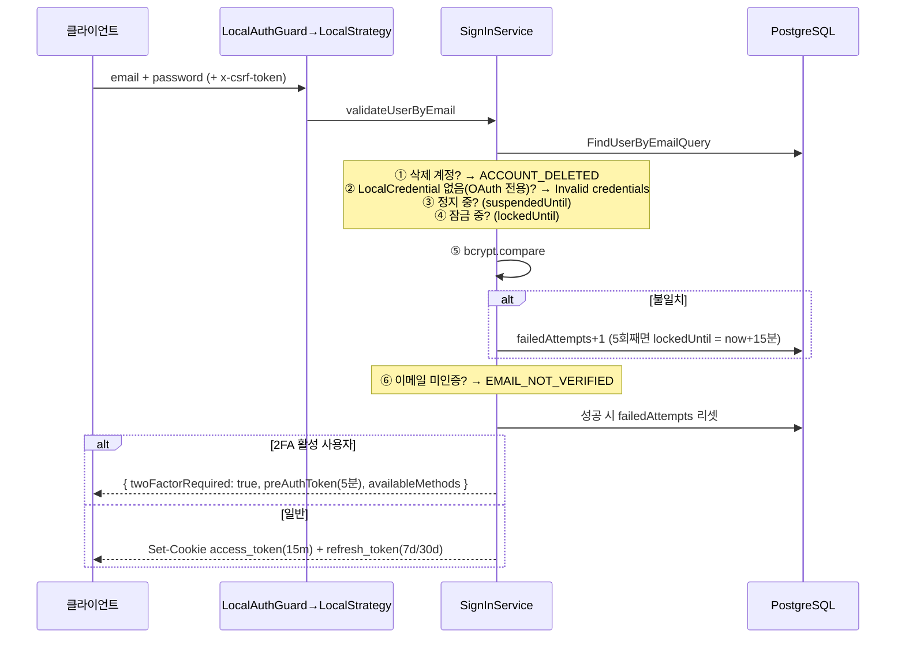
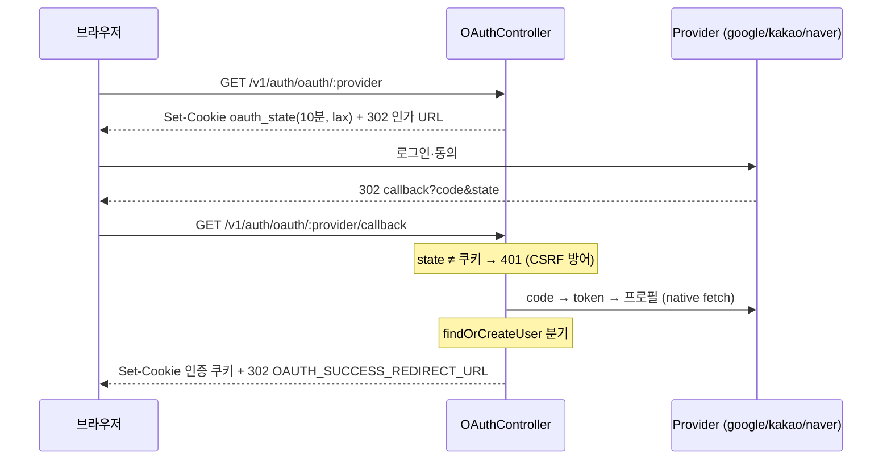

# 03. 인증

> 로그인 요청 하나가 어떤 검증을 거쳐 쿠키가 되는지, refresh가 어떻게 회전하는지, 2FA·OAuth가 어디서 분기하는지.
> 코드 위치: `apps/core-backend/src/core/auth/` (+ 비밀번호/이메일 변경은 `core/user/`)

## 한눈에 보기 — 토큰과 쿠키

| 이름 | 정체 | 만료 | 저장/전달 |
|---|---|---|---|
| `access_token` | JWT (payload `{ sub: userId }`, `aud: "access"`) | JWT 자체: `JWT_EXPIRES_IN`(기본 1h) / **쿠키: 15분** | HttpOnly 쿠키 |
| `refresh_token` | JWT 아님 — `randomUUID()` 문자열, DB `RefreshToken` 테이블에 **SHA-256 해시로 저장** | rememberMe 30일 / 기본 7일 | HttpOnly 쿠키(원문) + DB(해시) |
| preAuthToken | JWT (`aud: "pre-auth"`) — 2FA 진행용 | 5분 | 응답 body (쿠키 아님) |
| `oauth_state` | OAuth CSRF 방지 state | 10분 | HttpOnly 쿠키, sameSite lax (form_post provider 인 Apple 만 none + secure) |
| `csrf-token` (prod: `__Host-csrf-token`) | CSRF double-submit 쿠키 | — | HttpOnly 쿠키 |

쿠키 옵션: `httpOnly: true`, `secure: production`, `path: '/'`, `sameSite: 'lax'` — 세팅·삭제가 공용 헬퍼(`core/auth/utils/auth-cookie.util.ts`) 하나로 통일되어 있습니다. 비밀번호 해시는 전 구간 **bcrypt cost 10**입니다.

## 1. 로그인 — `POST /v1/auth/sign-in`



짚어둘 동작:

- **검증 순서가 곧 에러 메시지 순서**입니다 — 정지/잠금은 비밀번호 확인 *전에*, 이메일 미인증은 *후에* 검사합니다
- **계정 잠금**: 5회 실패 → 15분 잠금 (`LocalCredential.failedAttempts/lockedUntil`, `repositories/increment-failed-attempts.command.ts`). 카운터는 **성공 로그인 시에만 리셋**되므로, 잠금이 풀린 뒤 첫 실패로 즉시 재잠금될 수 있습니다
- **2FA 사용자**는 이 시점에 쿠키를 받지 않습니다 — 5분짜리 preAuthToken만 받고 §4로 이어집니다
- Rate limit: 60초 10회 (`@Throttle`)

## 2. JWT 검증 — 요청마다 일어나는 일

`JwtAuthGuard`가 전역 등록되어 있으므로([00장 §2](00-overview.md#②-가드--전역-3종)) 모든 요청이 이 경로를 지납니다:

- **토큰 추출 우선순위** (`strategy/jwt.strategy.ts`): ① 쿠키 `access_token` → ② `Authorization: Bearer`(Swagger용) → ③ 쿼리 `?token=`
- **토큰의 종류는 `aud` 로 가릅니다** (`strategy/token-audience.ts`). 액세스 토큰과 pre-auth 토큰은 같은 `JWT_SECRET` 으로 서명되므로, 종류를 보지 않으면 2FA 전 토큰이 액세스 토큰으로 통합니다. JwtModule 의 기본 sign·verify 옵션과 `JwtStrategy` 가 `aud: "access"` 를 요구해 jsonwebtoken 이 검증 단계에서 거절합니다 — 읽는 쪽이 확인을 잊을 수 없습니다
- `validate()`는 사용자를 DB에서 재조회해(탈퇴면 거절, 정지면 거절) `req.user = { id, username, isLogin: true, userSetting }`을 만듭니다
- `@Public()` 라우트도 **같은 `JwtStrategy`** 로 검증해 `req.user`를 채웁니다. 실패(없음·만료·종류 다름·탈퇴·정지)하면 막지 않고 `{ isLogin: false }` 로 둡니다. 🔴 공개 라우트에서 토큰을 따로 검증하지 마세요 — 예전에 서명만 보는 별도 검증이 있어 pre-auth·탈퇴·정지 토큰이 공개 라우트에서 로그인으로 통했습니다 (`guards/jwt-auth.guard.spec.ts`). `aud` 를 넣기 전에 발급된 액세스 토큰은 배포 직후 거절되어, 로그인한 사람은 한 번 refresh 를 거치거나(자동) 공개 화면을 잠깐 비로그인으로 봅니다

## 3. Refresh 회전 — `POST /v1/auth/refresh`

1. 쿠키의 `refresh_token`을 **해시해** DB 조회 (`token @unique`) — 없거나 만료면 401 + 쿠키 정리
2. **회전** — 기존 토큰을 삭제하지 않고 `rotatedAt`으로 마킹(재사용 감지용), 만료·오래된(7일 경과) 회전 토큰은 정리
3. 새 refresh 토큰 발급 — **잔여 유효기간을 승계**합니다 (연장 아님, 최소 1일). "30일마다 갱신하면 영원히 로그인"이 아니라 rememberMe 기간이 상한
4. 새 access token + 쿠키 재설정

**재사용(탈취) 감지** — 이미 회전된(`rotatedAt`이 찍힌) 토큰이 다시 제시되면:

- **grace window(30초) 이내**: 정상 경합(응답 유실 후 재시도, admin 로그인 페이지 재방문 등)으로 보고 조용히 401만 반환
- **초과**: 탈취로 간주해 **해당 유저의 전 세션을 무효화** + warn 로그. 회전된 토큰을 삭제하지 않고 보존하는 이유가 이 감지를 성립시키기 위해서입니다

특성 (설계 판단 시 알아둘 것):

- 토큰은 DB에 **SHA-256 해시로 저장**됩니다(원문은 쿠키로만). DB가 유출돼도 토큰을 곧바로 재사용할 수 없습니다
- `RefreshToken`에 `ipAddress`/`userAgent`가 기록되어 세션 관리 화면(§7)의 데이터가 됩니다 (단, OAuth 로그인 경로는 IP/UA 미기록)
- 프론트 ApiClient는 401을 받으면 이 엔드포인트로 1회 자동 재시도하며, 동시 요청은 `refreshQueue`로 단일 refresh에 수렴시켜 오탐을 줄입니다 → [08장 §3](08-frontend.md#3-apiclient)

## 4. 2FA — TOTP + 이메일 OTP

상태는 모두 `LocalCredential`에 있습니다: `totpEnabled`/`totpSecret`, `emailOtpEnabled`. 진행 중 코드는 `TwoFactorChallenge`(codeHash — bcrypt, 만료 10분). **`totpSecret`은 AES-256-GCM으로 암호화해 저장**됩니다(`TOTP_ENCRYPTION_KEY`, `v1:iv:tag:ct` 포맷). 배포 전 저장된 legacy 평문 secret은 다음 인증 성공 시점에 자동으로 암호문으로 재저장됩니다(lazy migration).

> ⚠️ **`TOTP_ENCRYPTION_KEY`는 불변으로 취급하세요.** 키를 바꾸면 기존 암호문(GCM 태그)의 복호화가 실패해 해당 사용자의 TOTP가 잠깁니다. 키 로테이션이 필요해지면 `v2:` 포맷 + 이중 복호화 폴백을 도입하는 것이 안전합니다(현재 미구현).

**설정** (로그인 상태에서):

- TOTP: `POST /2fa/totp/setup` → secret 생성 + QR data URL(otplib+qrcode, issuer "Weaver2") → `POST /2fa/totp/confirm`으로 코드 검증 후 활성화. **이미 켜져 있으면 409** — 켜진 TOTP 는 등록 경로가 덮지 않고, 끄는 길은 코드를 요구하는 `DELETE /2fa/totp` 뿐입니다 (상태를 바꾸므로 GET 이 아니라 POST: GET 은 CSRF 검사가 없어 다른 사이트의 링크로 실행됩니다)
- 이메일 OTP: `POST /2fa/email/setup` → 6자리 코드 발송 → `POST /2fa/email/confirm`

**로그인 시 인증** (`@Public`):

```
sign-in → preAuthToken 수령
  → (이메일 방식이면) POST /2fa/email/send  — preAuthToken 검증 후 코드 발송
  → POST /2fa/authenticate { preAuthToken, method, code }
  → 검증 성공 시 SignInService.login으로 정식 쿠키 발급
```

- **백업 코드(recovery code)는 없습니다.** 복구 수단은 "다른 2FA 방법"뿐이므로, **마지막 남은 2FA 수단은 비활성화할 수 없게** 막혀 있습니다 (`DELETE /2fa/totp`, `/2fa/email`)
- Rate limit이 촘촘합니다: authenticate 5회/60초, 이메일 발송·설정 3회/60초

## 5. OAuth — Google · Kakao · Naver · Apple

Passport를 쓰지 않는 native fetch 구현입니다 (CHARTER §5). Provider들은 `OAuthProvider` 인터페이스로 통일되어 `OAuthProviderRegistry`에 등록됩니다 (`oauth/oauth.module.ts`) — 새 provider 추가 = 구현체 하나 + 등록 한 줄.



`findOrCreateUser`의 3분기 (`oauth/oauth.service.ts`):

1. `(provider, providerId)`의 OAuthAccount 존재 → 기존 사용자 로그인
2. 없는데 **같은 이메일의 계정이 존재 → `ConflictException`** — 자동 연동하지 않습니다 (이메일만 알면 계정을 탈취할 수 있으므로). 프론트는 `?error=oauth_email_conflict`로 안내하고, 사용자는 로그인 후 설정에서 수동 연동합니다
3. 둘 다 없음 → 신규 가입 (username은 `{provider}_{providerId 앞 8자}` + 충돌 시 랜덤 suffix)

4. 신규 가입인데 provider 가 검증된 이메일을 주지 않음 → 사용자를 만들지 않고 실패 (provider·providerId 를 경고 로그로 남김)

켜진 로그인 수단은 `GET /v1/auth/providers` (공개)가 알려 줍니다 — `{ password, google, kakao, naver, apple }`. OAuth 는 registry 에 등록돼 있고 `*_CLIENT_ID` 가 채워져 있어야 `true` 입니다. 로그인 화면은 이 값으로 버튼을 그립니다. 파생 프로젝트는 전역 모듈에서 `AUTH_PROVIDER_EXTRAS` 토큰으로 칸을 더할 수 있습니다(`oauth/auth-provider-extras.ts` — upstream 칸은 덮어쓰지 못함).

### Apple — 다른 provider 와 다른 점

`APPLE_OAUTH_ENABLED=true` 일 때만 registry 에 등록됩니다 (기본 꺼짐 — Apple Developer 멤버십이 있어야 Services ID·키를 만들 수 있음). `providers/apple.provider.ts`.

| 무엇 | 다른 provider | Apple |
|---|---|---|
| 콜백 | `GET …/callback?code&state` | `response_mode=form_post` — appleid.apple.com 이 **크로스사이트 POST** 로 보냄 → `POST /v1/auth/oauth/:provider/callback` |
| state 쿠키 | `SameSite=Lax` | `SameSite=None; Secure` — Lax 는 크로스사이트 POST 에 실리지 않음 |
| CSRF·CORS | 그대로 | 그 콜백 경로 하나만 `security.middleware.ts` 의 `CROSS_SITE_CALLBACK_PATHS` 로 면제 — 위조는 state 대조가 막음 |
| 사용자 정보 | userinfo API | 없음 — code 교환 응답의 `id_token` 을 Apple JWKS 로 검증(RS256 서명·iss·aud·exp)해 읽음 |
| client_secret | 고정 문자열 | `.p8` 키로 서명한 ES256 JWT (요청마다 5분짜리로 만듦, Apple 상한 6개월) |
| 식별자 | provider 의 id | `id_token.sub` — email 은 나중 로그인에서 빠질 수 있고, 「이메일 숨기기」면 `@privaterelay.appleid.com` |

- **이름은 첫 승인 때 form 의 `user` 로 한 번만 옵니다.** 그 첫 콜백이 실패하면 사용자가 appleid.apple.com 에서 연결을 끊기 전까지 다시 받을 수 없습니다
- `email_verified`·`is_private_email` 은 boolean 으로도, 문자열 `"true"` 로도 옵니다 — 둘 다 받습니다
- Apple `refresh_token` 은 `OAuthAccount.refreshToken` 에 저장됩니다 — 앱스토어 심사 5.1.1(v) 의 「계정 삭제 시 토큰 철회(`/auth/revoke`)」에 필요합니다 (철회 호출 자체는 아직 없음)
- 개인키는 `APPLE_PRIVATE_KEY_PATH`(권장) 또는 `APPLE_PRIVATE_KEY`(`\n` 이스케이프 허용)
- return URL 에 localhost·IP 는 등록할 수 없습니다 — 실제 왕복 시험에는 HTTPS 도메인(터널)이 필요합니다

연동 관리: `GET /oauth/connections`, `DELETE /oauth/connections/:provider` — **LocalCredential 없는 OAuth 전용 계정은 마지막 연동을 해제할 수 없습니다** (로그인 수단이 사라지므로).

## 6. 회원가입·비밀번호·이메일 변경

| 플로우 | 토큰/코드 | 만료 | 비고 |
|---|---|---|---|
| 회원가입 이메일 인증 | 64자 hex (`randomBytes(32)`), DB엔 SHA-256 해시 저장 → 원문은 링크 | 1시간 | 약관 동의 필수, 재발송은 열거 방지 위해 항상 동일 응답. **`POST /v1/auth/verify { token, password }` — 가입 때 정한 비밀번호까지 맞아야 인증** (틀리면 400 `VERIFY_PASSWORD_MISMATCH`, 토큰은 남김) |
| 비밀번호 재설정 (비로그인) | 64자 hex, DB엔 해시 저장 → 원문은 링크 | 1시간 | 유저 없어도 성공 응답 (열거 방지). **전체 세션 무효화**, **미인증 계정이면 인증까지 완료**(마케팅 수신 동의는 되돌림). 보낸 지 10분 안의 링크는 새 요청이 덮어쓰지 않음 |
| 비밀번호 변경 (로그인) | 현재 비밀번호 확인 | — | **전체 세션 무효화** (`DeleteRefreshTokensByUserIdCommand`) |
| 이메일 변경 (로그인) | 6자리 코드 (bcrypt 해시 저장) → 새 이메일로 발송 | 10분 | 현재 비밀번호 확인 필수. 세션 무효화 없음 |

**인증 링크가 비밀번호를 함께 받는 이유 — 미인증 선점 가입.** 공격자가 남의 이메일로 자기 비밀번호를 정해 가입해 두면 인증 메일은 진짜 주인에게 갑니다. 토큰만으로 인증되면 주인이 링크를 누르는 순간 공격자 비밀번호가 살아나 계정을 빼앗깁니다. 그래서 인증은 가입 때 비밀번호까지 확인하고, 그 비밀번호를 모르는 주인은 **재설정**(메일함 소유 증명 → 인증 완료 · 세션 전부 무효화)으로 계정을 되찾습니다. 가입 화면은 409 충돌 때 이 길을 안내합니다.

- 재설정 토큰은 계정마다 하나라 새로 발급하면 앞 링크가 죽습니다. 남이 요청을 거듭 보내 주인의 복구 링크를 계속 죽이지 못하게, **보낸 지 10분 안에는 새로 발급하지 않습니다** (응답은 같음). 메일을 잃은 사용자는 10분 뒤 다시 요청합니다
- ⚠️ **파생 프로젝트 — 이 수정 전(토큰만으로 인증하던 때)에 배포했다면** 이미 선점 가입으로 넘어간 계정이 있을 수 있습니다. 그런 계정에서 공격자는 로그인할 수 있었으므로 TOTP 를 켜거나 자기 OAuth 계정을 연결해 두었을 수 있고, **재설정은 비밀번호와 세션만 바꿀 뿐 그 둘은 지우지 않습니다.** 배포 뒤 「가입 직후 인증되었고 그 뒤 TOTP·OAuth 연결이 생긴 계정」을 한 번 점검하세요

**변경(change)과 재설정(reset) 모두 전체 세션을 무효화**합니다 — 계정이 탈취된 상태에서 비밀번호로 복구할 때 공격자 세션이 살아남지 않게 하기 위함입니다. (이메일 변경은 세션을 건드리지 않습니다 — §10 out-of-scope.)

### 이메일은 소문자로 저장하고 정확 일치로 비교한다

`Victim@x.com` 과 `victim@x.com` 이 다른 계정이 되면 가입 충돌을 피해 같은 사람의 이메일을 선점할 수 있습니다.

- 들어오는 입구: 이메일을 받는 DTO 에 `@NormalizeEmail()` (`core/auth/utils/email.util.ts` — trim + 소문자)
- 저장소: 이메일을 찾거나 쓰는 repository 가 `normalizeEmail()` 을 한 번 더 거칩니다 (DTO 를 거치지 않는 로그인·OAuth 가입도 잡힘)
- DB: `CHECK (email = lower(email))` (`users`, `email_change_requests`) — 어느 경로가 빠뜨려도 DB 가 막습니다. Prisma 는 이 제약을 관리하지 않지만 지우지도 않습니다
- ❌ **Prisma `mode: 'insensitive'` 를 쓰지 마세요.** `ILIKE` 로 바뀌어 입력의 `%`·`_` 가 와일드카드가 됩니다 (`%@…` 로그인이 남의 계정을 잡고 실패 횟수를 올림). 인덱스도 못 탑니다
- ⚠️ **파생 프로젝트 배포 전:** 마이그레이션 `20261017120000_normalize_email_lowercase` 는 대소문자만 다른 계정이 있으면 **멈춥니다**(어느 계정을 남길지는 사람이 정함). 먼저 확인하세요:
  ```sql
  SELECT lower(trim(email)), array_agg(id) FROM users GROUP BY 1 HAVING count(*) > 1;
  ```
  ASCII 가 아닌 글자가 든 이메일이 있어도 멈춥니다 — Postgres `lower()` 는 DB 로케일(`SHOW lc_ctype`)을 따라 C 로케일이면 `É` 를 그대로 두므로, 앱이 만든 소문자와 어긋나 그 사용자가 로그인하지 못합니다 (`SELECT id, email FROM users WHERE email ~ '[^\x01-\x7F]';`). 소문자로 바꾸면 기존 계정과 겹치는 대기 중 이메일 변경 요청은 지웁니다. 사용자가 아주 많으면 CHECK 를 `NOT VALID` 로 건 뒤 `VALIDATE CONSTRAINT` 하는 편이 잠금이 짧습니다

## 7. 세션 관리 — `auth/sessions`

세션 = `RefreshToken` 레코드입니다:

- `GET /v1/auth/sessions` — 기기 목록 (`ipAddress`, `userAgent`, `createdAt`, `isCurrent` — 현재 쿠키와 매칭)
- `DELETE /v1/auth/sessions/:id` — 개별 로그아웃 (`userId` 조건 포함이라 타인 세션 삭제 불가)
- `DELETE /v1/auth/sessions/others` — 나머지 전부 로그아웃
- `POST /v1/auth/sign-out` — 현재 refresh 토큰 DB 삭제 + 쿠키 정리

## 8. CSRF

`csrf-csrf`(double-submit) 미들웨어가 전 요청에 적용됩니다 (`libs/common/src/global/middleware/security.middleware.ts`):

- `GET/HEAD/OPTIONS` 면제, 뮤테이션은 `x-csrf-token` 헤더 필수
- 그 밖의 면제는 `CSRF_EXEMPTIONS` 조건 목록에 모여 있습니다 (Swagger, Apple form_post 콜백) — 파생 프로젝트는 조건을 한 줄씩 더합니다
- 토큰 발급: `GET /v1/auth/csrf-token` (`@Public`) — 프론트 ApiClient가 자동 발급·캐시·403 시 재발급합니다
- 세션 식별: `refresh_token` 쿠키 ?? IP
- Swagger 요청은 면제 — `ORIGIN_URL`(백엔드 자신의 `host:port` 또는 origin)과 **정확히 같은** Origin, 또는 그 origin 의 `/docs`·`/docs/…` Referer 만. `ORIGIN_URL` 이 비면 면제 없음 (예전 부분 문자열 비교는 `https://evil.com/docs` 도 통과시켰다)
- 시크릿: `CSRF_SECRET ?? JWT_SECRET ?? fallback` — **운영에서는 `CSRF_SECRET`을 반드시 설정**하세요

## 9. Rate Limiting 요약

전역 60초/100회 + 민감 엔드포인트 오버라이드:

| 엔드포인트 | 60초당 |
|---|---|
| sign-in | 10 |
| 2fa/authenticate | 5 |
| 2fa/email/send·setup, verify/resend, password/request-reset, users/me/email | 3 |
| sign-up/email, verify, password/reset, users/me/email/confirm | 5 |
| refresh | (전역 100만 적용) |

버킷은 클라이언트 IP(`req.ip`)별입니다. 프록시(Next.js rewrite·nginx) 뒤에서 `req.ip` 가 127.0.0.1 로 뭉치지 않도록 백엔드는 `TRUST_PROXY`(기본 `loopback`, `libs/common/src/global/middleware/trust-proxy.ts`)로 X-Forwarded-For 를 읽습니다. 앞단 nginx 는 XFF 를 `$remote_addr` 로 **덮어써야** 합니다 — Next rewrite 는 XFF 가 있으면 그대로 넘기므로 덮지 않으면 클라이언트가 IP 를 골라 한도를 우회합니다 (`scripts/setup.sh` 주석).

⚠️ **`THROTTLE_DISABLED=true`일 때만 `DevThrottlerGuard`가 모든 rate limit을 통과시킵니다** — `NODE_ENV` 와는 무관합니다(예전엔 `development` 면 꺼져, `.env.example` 을 그대로 배포한 서버에서 스로틀이 조용히 꺼졌습니다). 통합 테스트는 `setup.ts` 에서 이 플래그를 켭니다 ([09장](09-testing.md)).

⚠️ **IP 별 한도는 진짜 클라이언트 IP 를 읽어야 동작합니다** — `TRUST_PROXY`(기본 `loopback`)로 같은 호스트 프록시의 `X-Forwarded-For` 를 믿습니다. Next 의 rewrite 는 클라이언트가 보낸 XFF 를 그대로 넘기므로(비어 있을 때만 채움) **Next 를 인터넷에 바로 노출하지 말고 앞에 nginx 등 리버스 프록시를 두세요** — 프록시가 실제 IP 를 덧붙이거나(`$proxy_add_x_forwarded_for`) 덮어쓰면(`$remote_addr`) 위조가 막힙니다.

## 10. 알아둘 트레이드오프 (사실 기반)

**남은 트레이드오프** (보안 요구가 높은 fork에서 재검토 대상):

1. access_token 쿠키 수명(15분)과 JWT 만료(기본 1h)가 불일치 — 실효 수명은 짧은 쪽(15분)
2. **이메일 변경·2FA 비활성화 시 세션 무효화 없음** (의도적 out-of-scope). 필요하면 변경/재설정 경로처럼 `DeleteRefreshTokensByUserIdCommand`를 추가

**해소된 항목** (이전 버전 대비 — 심층 방어 보강):

- refresh·비밀번호 재설정·이메일 인증 토큰은 DB에 **SHA-256 해시 저장**, TOTP secret은 **AES-256-GCM 암호화**
- refresh **재사용(탈취) 감지** 도입 (grace window 30초, 초과 시 전 세션 무효화) → §3
- 비밀번호 **재설정 시에도 전체 세션 무효화**
- 인증 쿠키 **`sameSite: 'lax'` 명시**, 세팅·삭제 로직을 공용 헬퍼로 통일
- sign-in·2FA 응답 body에서 **토큰 평문 제거** (HttpOnly 쿠키 단일 경로)

## 더 보기

- 인증 데이터 모델: [02. 데이터 모델 §2.1](02-data-model.md#21-인증-authprisma)
- 전역 가드 체인: [00. 시스템 개요 §2](00-overview.md#2-백엔드-요청-수명주기)
- 프론트의 인증 처리(3중 방어): [08. 프론트엔드 §4](08-frontend.md#4-인증-상태--3중-방어)
- 보안 정책 전반: [`SECURITY.md`](../../SECURITY.md)
