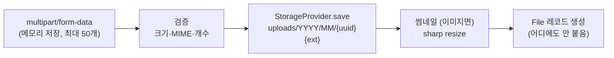

# 06. 파일 업로드

> 파일이 올라와서 저장되고, 썸네일이 만들어지고, **누가 받을 수 있는지 매번 판정된 뒤** 내려가기까지 — 그리고 Local↔S3 전환이 어떻게 한 줄로 가능한지.
> 설계: [`docs/design/specs/2026-10-17-file-access-control-design.md`](../design/specs/2026-10-17-file-access-control-design.md)
> 코드 위치: `libs/upload/`(코어) + `apps/core-backend/src/infrastructure/upload/`(컨트롤러)

## 1. StorageProvider 추상화 — 확장 포인트의 교과서

저장 백엔드는 인터페이스 뒤에 숨어 있습니다 (`libs/upload/src/providers/storage-provider.interface.ts`):

```ts
interface StorageProvider {
  save(file, dir, type: { ext, contentType, inline }): { storedName, path }  // type = 업로드 서비스가 검증한 형식
  saveBuffer(buffer, filename, dir): { storedName, path }
  read(path): Promise<Readable | null>          // /v1/files 가 스트림으로 내줄 때
  delete(path); exists(path);
  getFileUrl?(path, expiresInSeconds): Promise<string>  // 서명 URL 을 낼 수 있는 저장소만
}
```

구현 2종과 분기 지점:

| 구현 | 저장 | 내주는 방법 (`/v1/files`) |
|---|---|---|
| `LocalStorageProvider` | `uploads/YYYY/MM/{uuid}{ext}` 파일시스템 (cwd 기준, 웹에 내걸지 않는다) | `read` 로 **스트림** |
| `S3StorageProvider` | S3/MinIO (`S3_ENDPOINT` 있으면 `forcePathStyle` — MinIO 호환) | `getFileUrl` 로 **60초 서명 URL 302** |

> 직접 만든 저장소 공급자가 있다면 `read` 를 구현해야 합니다. 저장소 주소를 공개하는 `getFileUrl` 은 이제 선택이고, 있으면 **권한 판정 뒤에만** 쓰입니다.

분기는 `libs/upload/src/upload.module.ts`의 provider factory 한 곳: `STORAGE_DRIVER` env가 `s3`면 S3, 아니면 local. **서비스·컨트롤러 코드는 드라이버를 전혀 모릅니다** — CHARTER §5.1 "seam은 열되 구현은 필요한 것만"의 대표 사례입니다.

S3 필수 env: `S3_REGION`, `S3_ACCESS_KEY_ID`, `S3_SECRET_ACCESS_KEY`, `S3_BUCKET` (+선택 `S3_ENDPOINT`).

## 2. 업로드 플로우

`POST /v1/files` (`infrastructure/upload/controllers/files.controller.ts`) — **붙을 곳 없이** 올립니다:



1. **수신** — `FilesInterceptor('files', 50, { storage: memoryStorage() })`. Rate limit 1분 10회
2. **검증** — 값은 코드 하드코딩이 아니라 **SystemSetting(런타임 설정)**에서 옵니다 (`infrastructure/config/system-setting.service.ts`의 DEFAULTS):

   | 설정 키 | 기본값 |
   |---|---|
   | `uploadMaxFileCount` | 10 |
   | `uploadMaxFileSize` | 10 MiB |
   | `uploadAllowedMimeTypes` | jpeg, png, gif, webp, pdf, zip |
   | `uploadThumbnailWidth/Height` | 300×300 |
   | `uploadOrphanRetentionHours` | null (고아 정리 비활성) |

   관리자 화면의 시스템 설정에서 재시작 없이 변경할 수 있습니다.
3. **형식 확인** — 선언한 Content-Type 을 믿지 않습니다. `libs/upload/src/file-types.ts` 의 `UPLOAD_FILE_TYPES` 표에서 그 형식의 **시그니처(파일 앞 바이트)**가 맞아야 받습니다. 표에 없는 형식은 관리자 설정에 넣어도 거절됩니다 — 새 형식은 시그니처와 함께 표에 더하세요. SVG 처럼 스크립트를 품을 수 있는 형식은 넣지 않습니다
4. **저장** — 파일명은 provider가 `randomUUID() + 확장자`로 생성하되, **확장자는 사용자 파일명이 아니라 검증된 형식에서** 정합니다(`x.html` 을 `image/png` 로 올려도 `.png`). 원본 이름은 DB에 별도 보관

> ⚠️ **왜** — 확장자를 원본 파일명에서, 형식을 선언값에서 가져오면 `x.html` 을 `application/pdf` 로 올려 `<uuid>.html` 로 저장시킬 수 있었습니다. 그 파일은 우리 출처에서 HTML 로 열려(저장형 XSS) 연 사람의 쿠키로 무엇이든 할 수 있습니다. 프로필 이미지(`update-user-profile.service.ts`)도 같은 표로 확인합니다
5. **썸네일** — 이미지 MIME(jpeg/png/gif/webp)이면 업로드 처리 중 **동기적으로** `sharp().resize(w, h, { fit: 'inside', withoutEnlargement: true })` 실행, `thumbnailKey`에 기록 (`libs/upload/src/services/thumbnail.service.ts`). 쿼리 파라미터 `generateThumbnail=false`로 끌 수 있음
6. **DB 기록** — `files` 한 행([02장](02-data-model.md)). 파일 기록은 **파일만 압니다** — 무엇에 붙었는지는 붙은 쪽(`post_attachments`·`users.profileImageFileId`·파생 프로젝트의 첨부 테이블)이 압니다. 응답 `FileDto` 의 `url`·`thumbnailUrl` 은 `${FILE_URL_BASE}/v1/files/:id`(기본 `/api`)이고 저장 키는 내보내지 않습니다
7. **붙이기는 붙는 쪽이** — 글 생성·수정의 `attachmentFileIds`(순서대로), 프로필 이미지 업로드. **내가 올렸고, 안 지웠고, 안 가렸고, 아무 데도 안 붙은 파일만** 붙습니다(§5). 붙지 않은 파일은 보존 기간 뒤 정리됩니다(§4)

## 3. 서빙 — `/v1/files` 하나

정적 `/uploads` 는 **없습니다**. 파일을 내주는 길은 `GET /v1/files/:id`, `GET /v1/files/:id/thumbnail` 하나이고(`@Public` + 선택적 인증), **받을 때마다** §5 의 판정을 거칩니다. 못 보는 파일은 403 이 아니라 **404** — 존재 여부를 알리지 않습니다.

- **local** — 통과하면 본문을 스트림합니다. 응답마다 `Content-Security-Policy: sandbox; default-src 'none'` · `X-Content-Type-Options: nosniff` 를 걸고, **이미지가 아니면 `Content-Disposition: attachment`**(PDF·ZIP 은 내려받기). Content-Type 은 저장 키의 확장자(검증된 형식에서 정해진 것)로 다시 정합니다. 형식 확인 전에 이미 저장된 파일도 이 헤더로 막힙니다
- **s3** — 통과하면 **60초짜리 서명 URL 로 302**. 서명 URL 이 응답 헤더를 덮어씁니다(`ResponseContentType` · `ResponseContentDisposition`) — 저장된 메타데이터 대신 키의 확장자로 정하고, 표에 없는 확장자(`.html` 등)는 `application/octet-stream` + `attachment`
- **캐시** — 권한·가림이 바뀌면 곧 반영돼야 합니다

  | 응답 | Cache-Control |
  |---|---|
  | local, 비회원도 보는 파일(`public`) | `public, max-age=300` + `ETag` — 가림·삭제가 **최대 5분** 늦게 반영되는 것을 받아들인다 |
  | local, 그 밖 | `private, no-cache` + `ETag` — 매번 권한을 다시 묻되 본문은 304 로 아낀다 |
  | s3 302 | `private, no-store` — 리다이렉트가 캐시되면 만료된 서명을 가리킨다 |

- 프런트는 같은 출처(`/api` 리라이트)로 부르므로 쿠키가 따라가 ``·`<a href>` 가 그대로 동작합니다. 첨부 이미지는 `next/image` 의 **`unoptimized`** 로 둡니다 — 최적화는 서버가 쿠키 없이 대신 받아 회원 전용 첨부가 404 가 됩니다
- ⚠️ **알고 가는 한계** — 액세스 토큰(15분)이 만료된 뒤의 `` 요청은 비로그인으로 판정됩니다. 프록시(`proxy.ts`)는 쿠키가 있는지만 보고 토큰을 갱신하지 않으므로, 한 화면에 오래 머문 뒤 회원 전용 첨부 이미지가 깨질 수 있습니다(새로 고치면 화면의 API 호출이 토큰을 갱신합니다)
- 권한별 응답과 헤더가 프록시를 지나서도 남는지는 `apps/core-frontend/e2e/file-access.spec.ts` 가 봅니다

## 4. 수명주기 — 붙이기, 떼기, 지우기, 정리

| 동작 | 어디서 | 규칙 |
|---|---|---|
| 글에 붙이기 | 글 생성·수정 `attachmentFileIds` | 새로 붙는 파일은 **글 작성자**가 올린 것만. 수정은 목록 전체를 바꾼다 — 작성자가 아닌 편집자(관리자)는 순서 바꾸기·떼기만 |
| 글에서 떼기 | 글 수정에서 목록에서 뺌 | 관계만 지워 고아로(`detachedAt`). **가린 첨부는 목록에 없어도 남긴다**(응답에 안 나가 클라이언트가 보낸 목록에 없으므로) |
| 프로필 지정 | `POST /v1/users/me/profile-image` | 인라인 이미지만. 이전 프로필 파일은 떼고 지움 표시 |
| 사용자 삭제 | `DELETE /v1/files/:id` | 본인 파일만. 지움 표시(`deletedAt`) + 글 첨부·프로필에서 뗀다 |
| 관리자 삭제 | `DELETE /v1/admin/files/:id` | 떼고 행 → 저장소 순으로 물리 삭제. **파생 프로젝트의 첨부에 붙어 있으면 409** |
| 글 삭제 | — | 첨부를 건드리지 않는다. 지운 글은 읽기 정책이 막으므로 첨부도 막히고, 글이 물리 삭제되면 관계가 사라져 고아가 된다 |
| 신고(MEDIA) 숨김 | 모더레이션 | `files.hiddenAt` — 관리자(`UPLOAD.READ`)만 받는다 |

**정리** — `UploadService.purgeOrphanedFiles(retentionHours)` 가 「어디에도 안 붙은 채 보존 기간이 지난 파일」(한 번도 안 붙었으면 올린 때부터, 떼어졌으면 **뗀 때부터**)과 「지운 지 보존 기간이 지난 파일」을 물리 삭제합니다. 순서는 **행 먼저** — 아직 어딘가에 붙어 있으면 FK(Restrict)가 막고 그 파일은 건너뜁니다. 그다음 저장소 객체. 스케줄러는 `ContentPurgeScheduler`(매시 정각)가 겸하며, **`uploadOrphanRetentionHours` 설정이 null(기본)이면 동작하지 않습니다**.

## 5. 접근 통제 — 「누가 받나」는 붙은 쪽이 정한다

`FileAccessService.canRead(file, viewer)` (`infrastructure/upload/file-access/`):

1. `deletedAt` → 아무도(관리자 포함 — 관리자는 관리 API 로)
2. `hiddenAt` → `UPLOAD.READ` 를 가진 사람만
3. 등록된 규칙들을 묻는다 — 파일의 주인은 하나라 답은 많아야 하나. **둘 이상이 답하면 거절**하고 오류 로그(규칙 버그)
4. 아무 규칙도 자기 것이라 하지 않으면(어디에도 안 붙음) → 올린 사람만

본체 규칙: **게시글 첨부**는 `PostReadPolicy`(글 상태 → 게시판 READ → 비밀글은 작성자·게시판 관리자, [07장](07-board-reference.md))를 그대로 따르고 비회원도 읽는 글이면 `public`. **프로필 이미지**는 `public`(탈퇴한 사람의 것은 거절).

`viewer` 는 인증의 일원화된 검증을 거친 사용자입니다 — pre-auth·탈퇴·정지 사용자는 비로그인으로 들어옵니다.

### 내 첨부 테이블 더하기 (파생 프로젝트)

예: 문의(`inquiries`)에 파일을 붙인다.

1. **테이블** — `files` 를 향한 FK 는 반드시 `onDelete: Restrict`. `Cascade` 면 본체 정리가 그 파일을 고아로 보고 지우는 순간 내 첨부 행까지 조용히 사라집니다. `Restrict` 면 DB 가 「아직 붙어 있다」를 거절로 알려 주고 정리가 건너뜁니다

   ```prisma
   model InquiryAttachment {
     fileId    String  @id
     inquiryId String
     file      File    @relation(fields: [fileId], references: [id], onDelete: Restrict)
     inquiry   Inquiry @relation(fields: [inquiryId], references: [id], onDelete: Cascade)
   }
   ```
2. **붙이기** — 트랜잭션 안에서 `LockAttachableFilesCommand(tx, fileIds, userId)` 로 잠그고 확인한 뒤 행을 만듭니다(「내가 올렸고, 안 지웠고, 안 가렸고, 본체가 아는 곳에 안 붙음」). 내 테이블에 이미 붙었는지는 같은 잠금 뒤에 직접 확인하세요
3. **규칙** — `FileAccessRule` 을 구현하고 `onModuleInit` 에서 `FileAccessRuleRegistry.register(this)`. 내 테이블에 그 파일이 없으면 `null`(다음 규칙으로), 있으면 `public`/`allow`/`deny`. 예시는 `file-access-rule.ts` 주석
4. **떼기** — 내 첨부 행을 지운 뒤 `files.detachedAt` 을 찍으면 보존 기간이 뗀 때부터 다시 셉니다

> 설계서는 `FILE_ACCESS_RULES` 토큰을 그렸지만, Nest 는 한 토큰에 공급자가 하나뿐이라 본체와 파생이 함께 규칙을 낼 수 없어 등록부로 바꿨습니다.

## 6. 배포 런북 — `post_files` 에서 `files` 로

마이그레이션 두 개가 한 번에 갑니다: `20261018200000_file_access_expand`(새 표·데이터 복사) → `20261018210000_file_access_contract`(옛 표·컬럼 삭제).

1. **백업**
2. **옛 코드가 돌고 있는 채로** `pnpm files:prepare-profile-import` — 프로필 이미지의 크기를 저장소에서 읽어 임시 표 `_profile_image_import` 에 씁니다(SQL 로는 크기를 알 수 없다). 프로필 이미지가 없으면 건너뛰어도 됩니다. 저장소에 없는 파일·모르는 확장자가 있으면 멈추니, 그 사용자의 `profileImagePath` 를 정리하고 다시
3. `pnpm db:deploy` → 재시작
   - 확장은 저장 키가 저장소 밖(`/…`·`..`)을 가리키거나, 프로필 이미지가 있는데 임시 표가 없거나 빠진 사용자가 있으면 **멈춥니다**
   - 축소는 `files` 로 옮겨지지 않은 `post_files`·프로필이 있으면 **멈춥니다**
   - 멈췄으면 `prisma migrate resolve --rolled-back <이름>` → 원인 해결 → 다시
4. 저장 파일은 **옮기지 않습니다**(키가 같다). 정적 `/uploads` 가 사라지므로 nginx 등에서 `/uploads` 를 따로 내걸었다면 지우세요

**API 변경** (파생 프로젝트가 확인할 것):

| 바뀌는 것 | 영향 |
|---|---|
| `/uploads/*` 정적 경로 → `/v1/files/:id` | 밖에 붙여 둔 옛 주소는 깨진다 |
| `/v1/upload*` → `/v1/files*`, `?postId=`·`PATCH link/unlink`·`GET :id`(메타)·`GET post/:postId` 없음 | 글쓰기: 업로드 → 글 저장 때 `attachmentFileIds`. 첨부 목록은 글 상세 응답의 `attachments` |
| `/v1/admin/upload` → `/v1/admin/files` | 관리자 화면 |
| `FileDto` 에서 `storedName`·`postId` 빠짐 | — |
| `StorageProvider.read` 추가, `getFileUrl` 선택 | 직접 만든 저장소 공급자 |
| `FILE_URL_BASE`(기본 `/api`) | API 를 직접 부르는 파생 프로젝트는 바꾼다 |
| 사용자 DTO 의 `profileImageUrl` | 그대로(계산값) |

## 트러블슈팅 지도

| 증상 | 확인 |
|---|---|
| 업로드 415/400 | SystemSetting의 MIME/크기 제한 (기본 6종, 10MiB) |
| 이미지인데 썸네일 없음 | MIME이 4종(jpeg/png/gif/webp)에 드는지, `generateThumbnail` 파라미터 |
| 첨부가 404 | 그 글을 읽을 수 있는지(회원 전용·비밀글·가림), 액세스 토큰 만료(§3 한계), 파일이 지움·가림 상태인지 |
| 첨부 이미지가 회원에게도 깨짐 | `next/image` 에 `unoptimized` 가 빠졌는지 |
| 글 저장이 400 「붙일 수 없는 파일」 | 남이 올렸거나, 이미 다른 곳에 붙었거나, 지움·가림 상태 |
| 관리자 삭제가 409 | 파생 프로젝트의 첨부 테이블에 붙어 있다 — 그쪽에서 먼저 뗀다 |
| 디스크가 참 | 고아 정리 활성화 여부 (`uploadOrphanRetentionHours`) |

## 더 보기

- 확장 포인트 목록: [`CHARTER.md`](../../CHARTER.md) §6
- 파일 모델: [02. 데이터 모델](02-data-model.md)
- 게시글 첨부 흐름: [07. 게시판 (레퍼런스 도메인)](07-board-reference.md)
